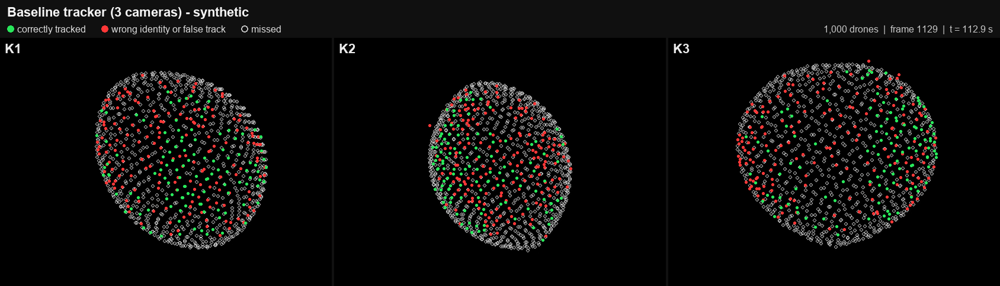

# SwarmLights-1K v2.1 (synthetic)



8 synthetic shows, 500-1,000 identical drones, 3 calibrated cameras, exact 3-D ground truth.

On all 8 shows, the released 3-camera baselines (T4c, T5) score below the best single camera: best single-camera IDF1 0.494–0.703, best 3-camera IDF1 0.325–0.525 (per-show table in `docs/DATASET_T5_RESULTS.md`). The two are not directly comparable: the single-camera score is 2-D (pixels, only drones that camera sees), the 3-camera score is 3-D (metres).

**Can you make three cameras beat one?**

> **Synthetic data.** Generated by the SwarmLogic simulator. Not a real show, and not validated against real footage with ground truth. Rendering is idealised (point-like LEDs, exact calibration, synchronised cameras, no camera shake). See *Limits*.

<sub>Animation: the released T5 baseline (`baselines_T5.tar`) on show n1000_s23, airborne IDF1 0.2641 over the whole show; frames 1129–1188 (t = 112.9–118.8 s, sphere turning into a heart). Green = correct identity (track within 1 m of the drone that IDF1's identity assignment gives it). Red = wrong or false track (wrong identity, or no drone within 1 m). Grey ring = missed drone (no track). Classified with the `score.py` rules (1 m match, drones seen by ≥ 2 cameras). Views are cropped to the formation; the camera video is dimmed to grey underneath. MP4: `assets/swarmlights_baseline.mp4`.</sub>

**Can a computer keep track of 1,000 identical lights?**

- Data (8 show archives + T5 baseline outputs, about 2.1 GB): https://huggingface.co/datasets/forgottenl5/swarmlights
- Code, scoring and docs: https://github.com/forgottenl5/swarmlights
- Checksums of every archive: `checksums/ARCHIVES.sha256`

SwarmLights is a synthetic benchmark for tracking every drone in a dense night-time drone light show from three calibrated audience-side cameras. Shows have 500 or 1,000 drones, with exact 3-D ground truth for every drone in every frame. In our (non-exhaustive) search, the densest public drone-tracking dataset we found has at most a few dozen drones per frame. Tracking thousands of near-identical points from a few calibrated cameras is, however, well studied in experimental fluid mechanics ([Shake-The-Box](https://archive.pco.de/fileadmin/user_upload/Applications/Shake_the_Box/Daniel_Schanz_Shake_the_box_paper.pdf), Schanz et al.) and in starling-flock tracking ([STARFLAG](https://arxiv.org/abs/0802.1667), [GReTA](https://arxiv.org/abs/1305.1495)). Those methods were built for 80-500 fps scientific cameras; whether they work on 10 fps compressed show video is untested and is the most direct next baseline. At these shows' speeds a drone moves at most 0.4 m between frames against 2.12 m spacing, so frame rate alone may not be the obstacle; merged lights and compression probably are. At real-show speed and spacing (up to 10 m/s, 1.4 m) frame rate would matter more. (Version 1 of our report missed this literature.)

## The open problem
With exact detections, the T5 baseline is near-perfect on every show (airborne IDF1 ≥ 0.995). From the rendered camera images it falls to 0.26–0.53, because neighbouring lights merge into one blob, formations seen edge-on collapse into a few blobs, and the front of a 3-D shape hides the back.

**On every show, both three-camera trackers still score below the best single camera.** Making three cameras beat one in dense formations is the challenge this benchmark sets.

Two failure modes are documented (see `docs/`):
1. **Ghost points:** two cameras' lines of sight through two different drones cross where there is no drone. In regular formations this is common. Third-camera verification of new tracks (baseline T5) removes 48–82 % of false tracks.
2. **Drones inside merged blobs:** a real drone hidden in a merged blob in one camera cannot be confirmed by three cameras, so it is missed. Particle tracking (Shake-The-Box) handles a similar problem by subtracting predicted images and searching what remains; untested on this data.

## What is in it
8 shows, 8 different choreographies (500 and 1,000 drones, seeds 20–23). One archive per show; inside:
- `video_K1.mp4`, `video_K2.mp4`, `video_K3.mp4`: camera videos, 1920×1080, 10 fps, H.264 with phone-like compression; coloured LEDs, glow, sensor noise and 10 non-drone lights near the horizon.
- `calibration.json`: exact camera positions, orientations and focal length.
- `gt.csv.gz`: every drone in every frame: 3-D position (m), LED colour, pixel position and in-frame flag per camera.
- `distractors.json`: the non-drone lights (they must not be tracked).
- `detections_K{1,2,3}.csv.gz`: reference detections (`frame,u,v`, pixels) from a simple blob detector, used by the baselines.
- `show.json`: choreography and phases; `spacing.json`: safety checks.
- `baselines/`, `metrics.json`: outputs and scores of the single-camera and T4c baselines.
- `SHA256SUMS`: a checksum for every file.

`preview/` is a small sample (not needed for the benchmark; the archives are unchanged):
- `preview/images/` (shown in the dataset viewer): 600 PNGs, 1280×720 (downscaled from the 1920×1080 videos): 100 frames spread over shows n500_s20 and n1000_s23, from all 3 cameras. `metadata.csv` gives `show, n_drones, camera, frame, time_s, n_airborne` (`n_airborne` = drones higher than 0.5 m in that frame).
- `preview/tracks_sample.csv` (download only, not in the viewer): ground truth for 20 of those frames of n1000_s23 (all 1,000 drones): `x_m, y_m, z_m` and the pixel position `u_K*, v_K*` in each camera, in original 1920×1080 pixels (multiply by 2/3 for the preview images); blank if the drone is outside that camera's frame.

`baselines_T5.tar` adds the T5 baseline outputs and scores for all 8 shows. It is a separate archive so the show archives stay byte-identical to their registered fingerprints.

Planned flight paths stay within these limits (checked): speed ≤ 4 m/s, acceleration ≤ 2 m/s², and every pair of drones at least 2.12 m apart in every frame. Real shows fly closer and faster (see *Limits*).

## Benchmark and scoring
Track every airborne drone in 3-D, then run:

```
pip install numpy pandas scipy motmetrics
python score.py your_tracks.csv <show_dir>
```

### Reproducing the baselines
`python baselines/run_baseline.py T5 <show_dir> t5.csv.gz` (or `T4c`) reruns a baseline from the reference detections.
- T5 reproduces the published outputs: the decompressed CSV is identical on Linux/macOS; on Windows line endings differ (CRLF), content identical after normalising (see *Known issues*).
- T4c does not quite: the published T4c runs used unrounded detections, while the released detection files are rounded to 0.001 px. The tracker is sensitive enough that this shifts its scores slightly (for example n500 s22 airborne IDF1 0.454 rerun vs 0.448 published).
- Rerun on all 8 shows from the released detections, T4c airborne IDF1 moves by at most 0.006 and MOTA by at most 0.006, except n1000 s22 (MOTA 0.274 published, 0.318 rerun). On these identical inputs T5 still has higher IDF1 than T4c on 6 of 8 shows, the same outcome as the registered comparison.

`your_tracks.csv` has columns `frame,track,x,y,z` (0-based frame, your identity number, metres in the `gt.csv.gz` frame). The script prints MOTA, IDF1, misses, false positives and ID switches. Rules: ground truth is every drone seen by at least 2 of the 3 cameras; match distance 1.0 m; airborne frames only (every phase except the take-off climb and final descent). `score.py` reproduces the published baseline scores (checked on T5 and T4c; the CSV outputs are rounded to 0.1 mm, which can move a single match at the 1 m boundary).

### Baselines (airborne, mean of 4 shows)

| Baseline | Input | 500 drones MOTA / IDF1 | 1,000 drones MOTA / IDF1 |
|---|---|---|---|
| Best single camera (2-D, pixels) | one video | 0.715 / 0.587 | 0.620 / 0.515 |
| T4c: three-camera 3-D | three videos | 0.415 / 0.451 | 0.206 / 0.365 |
| T5: T4c + shared detections + third-view check | three videos | 0.512 / 0.486 | 0.377 / 0.401 |
| T4c with exact detections (ceiling) | ground truth + 0.3 px noise | 1.000 / 0.999 | 0.925 / 0.835 |
| T5 with exact detections (ceiling) | ground truth + 0.3 px noise | 1.000 / 0.999 | 0.996 / 0.996 |

Single-camera and 3-D scores are not strictly comparable (pixels vs metres; the 2-D score only counts drones visible to that camera), but the gap is large and consistent. Per-show numbers are in `docs/DATASET_V2_1_RESULTS.md`, `docs/DATASET_T5_RESULTS.md` and `docs/DATASET_T5_RESULTS_ADDENDUM_1.md`. The docs are published as written; references in them to other documents or to `core/` modules point to the private project and are not included.

## How it was made and checked
Every study was written down and fingerprinted (SHA-256) before it ran, and code was frozen before each build. These fingerprints were recorded privately, not publicly timestamped, so the timing has to be taken on trust; future studies will post fingerprints publicly before running. The generator is not public, so these checks cannot be rerun from seeds by others; `score.py`, the baselines and the per-file checksums can. Checks: frames rebuild from seeds (minimum PSNR 39 dB), ground-truth pixel positions recompute to < 0.01 px, detections reproduce exactly from the videos, and all files are checksummed.

**Checking the fingerprints yourself.** `sha256sum -c checksums/REGISTERED_FILES.sha256` checks every released file that has a registered fingerprint: the three tracker files (the exact code frozen before scoring), the pre-registrations, the amendment and the results. The original fingerprint lists in `docs/` (`V2_1_FROZEN.sha256`, `T5_FROZEN.sha256`, `T5_RESULTS.sha256`) are published unchanged, so they use the private project's paths (for example `pilot_v2/mv_tracker5.py` is `baselines/mv_tracker5.py` here) and also list files that are not released (the generator, build and analysis scripts). Running `sha256sum -c` on those lists directly will therefore report missing files.

Failed predictions are reported as failures, including:
- v2.1 W3: T4c's ceiling fell below 0.95 MOTA on 2 of the 4 1,000-drone shows.
- T5 P2: T5 did not beat the best single camera on any show (0 of 8; predicted ≥ 4).
- T5 was amended once before scoring, after its first version failed the development gate. The amendment, the failed version and both fingerprints are in `docs/`.

## Limits
- Synthetic: idealised LEDs, one camera layout, exact calibration, no camera shake, weather or lens distortion.
- Planned paths only: no wind, GPS error or drone failures are simulated. The spacing and speed checks apply to the plan, not to real flight.
- Sparser and slower than real shows: a show-drone maker specifies 1.4 m minimum spacing ([DAMODA L3](https://en.dmduav.com/products/l3.html)), an operator reports 2 m ([Sky Elements](https://inflightusa.com/articles/skyelementsdrones)), and show drones are rated up to 10 m/s ([UVify IFO](https://uvify.com/product/ifo)). SwarmLights keeps ≥ 2.12 m and ≤ 4 m/s, so real footage likely has more merged lights than this benchmark.
- Realism check v1 against two public phone videos (Wikimedia Commons, CC BY / CC BY-SA): dot size and crowding are within the real range; colour, clipping and compression were added in v2.1. This is a weak check with no ground truth.
- The baselines were developed on separate development shows, not on these 8.
- Not for safety certification of real shows.

## Known issues
- `baselines/run_baseline.py` writes its CSV in text mode, so on Windows every line ends in CRLF. A Windows T5 rerun is therefore not byte-identical to the published output, but its content is identical after normalising line endings to LF (checked on n1000_s23). On Linux/macOS the decompressed CSV is identical. The `.csv.gz` files themselves always differ because gzip stores the write time in its header, so compare the decompressed CSVs.

## Licence and credit
- **Data: CC BY-NC 4.0.** Free for research and other non-commercial use, with credit. Commercial use, including training commercial products, needs a separate licence: open an issue on GitHub to ask.
- **Code: Apache-2.0** for `score.py` and the two baseline trackers.
- **Not released:** the SwarmLogic planning engine and show generator. The data was produced with them; the build checks above were run by the author.
- Cite as: SwarmLights-1K v2.1 (2026), forgottenl5 / SwarmLogic. https://github.com/forgottenl5/swarmlights
- Technical report: forgottenl5 / SwarmLogic (2026), *SwarmLights-1K: a synthetic benchmark where three cameras lose to one*, Zenodo. https://doi.org/10.5281/zenodo.24294705
- Questions and results: open an issue on GitHub.
- Need data for other formations, camera layouts or swarm sizes? Open an issue to ask about custom synthetic data.

## Intended use
Research on dense multi-object tracking, multi-view association and crowded-scene detection, for drone light shows and similar civilian settings.
